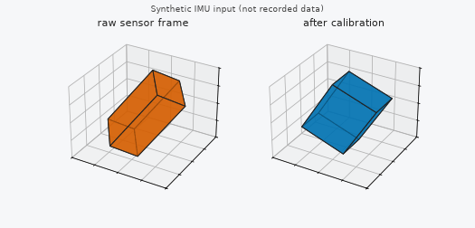
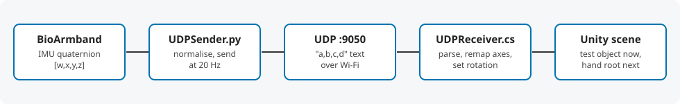
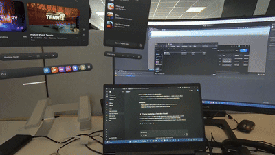
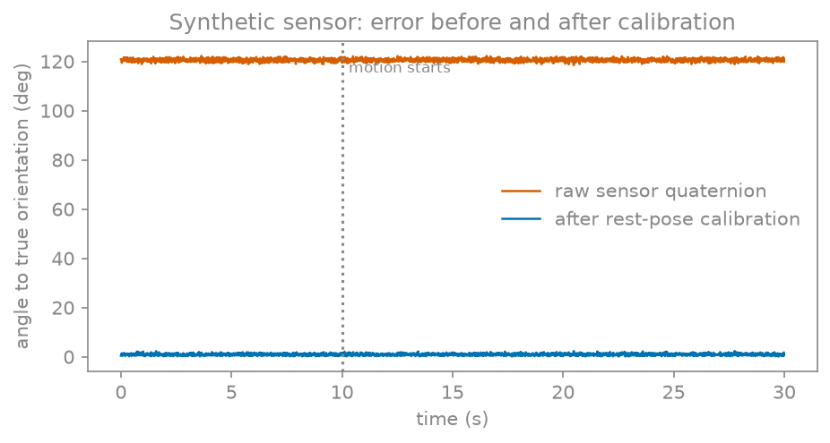
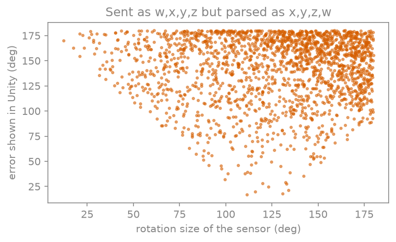

> What is this project about?

Making a virtual limb in a Meta Quest follow a sensor armband instead of the headset's own hand tracking. Work in progress.

## TLDR

**Problem.** The Quest tracks hands with cameras that only see what is in front of the wearer. A forearm or prosthesis outside that view, or one that doesn't look like a hand, can't be tracked, and the side cameras are locked.

**Approach.** Use a BioArmband (IMU + EMG) as the pose source. Stream its orientation to the Quest over UDP, convert it to the headset frame, and feed it into the Unity hand skeleton by overriding the root pose.

**Where it stands.**
- Done: armband to Quest data path, a Unity receiver that rotates a test object, a rest-pose calibration, a `CustomSkeletonModifier` hook inside `OVRSkeleton`.
- Not done: reliable orientation alignment on real data, position estimation, driving the hand skeleton from the UDP stream.
- Found while preparing this repo: the sender and receiver disagree on quaternion component order (see problem 3).



*The animation uses synthetic motion, not recorded data.*

## Repo map

```
Assets/UserScripts/   Unity scripts: UDP receiver, custom skeleton, modified OVRSkeleton
Code/                 Python for the BioArmband: UDP sender, orientation plots, IMU experiments
Documentation/        Working notes, literature survey, weekly task list
analysis/             Scripts that regenerate every figure in media/
media/                Figures and animations used in this README
docs/                 Data sources, known mismatches, metrics JSON
```

## Problems we had to solve

1. Camera-based hand tracking cannot see the limb, and the side cameras are not accessible.
2. The armband and the Quest are separate devices, so orientation has to travel between them in real time.
3. The sensor's frame is not the Unity frame, so the raw quaternion rotates the wrong way until it is converted.
4. Meta's hand skeleton is driven inside SDK code (`OVRSkeleton`), which has to be modified to accept outside data.
5. Position of the limb is not available from an IMU orientation alone.

## Approach we took

The data path is short: the armband streams IMU quaternions to a PC, a Python script sends them as text over UDP, and a Unity script on the Quest parses them.



The focus of our work was on the pieces that join the armband to Unity:

- **Sender** (`Code/UDPSender.py`): reads the newest quaternion, normalises it, sends it at 20 Hz.
- **Receiver** (`Assets/UserScripts/UDPReceiver.cs`): listens on a background thread so the render loop isn't blocked, parses the four numbers, remaps axes and sets the object's rotation on the main thread.
- **Calibration** (`Code/read_and_plot.py`): record a rest period, average the quaternions with the eigenvector method, and apply the inverse of that average to every later sample. A live cube visualises the result.
- **Skeleton hook** (`CustomSkeletonModifier`, `CustomOVRSkeleton.cs`): a class that takes the raw skeleton pose from the SDK and overrides chosen joints before bones are updated. We only plan to override the root, since finger poses will come from EMG classification later.
- **Position** (`pose_estimation_online.py`): an experiment to rotate acceleration into the global frame and integrate it. Not completed.

Meta's own `OVRSkeleton.cs` is modified rather than rewritten; the Meta SDK does the rest of the hand rendering.

What the course project did versus what this repo adds: nothing here is a regeneration of a finished project. The repo is the working code plus documentation, and the figures in `media/` are illustrations generated from scripts.

## Our solutions

**Problems 1 and 2: sensor as the pose source, sent over UDP.** This works: the test object in the scene follows the data from `UDPSender.py`. The headset's own camera view only sees the hands and the desk, which is why we moved to a body-worn sensor.



*Quest passthrough recording (first 4 s of a video in `Documentation/Documents/`).*

**Problem 3: frame conversion.** The calibration step removes a fixed mounting offset. On a synthetic sensor with a 1 deg noise level, the median error drops from about 121 deg to about 0.9 deg (`docs/metrics/calibration.json`). That is a check of the maths only. On the real armband, alignment stayed unreliable and took a long time to settle.



One likely contributor is a component-order mismatch between sender and receiver. The sender writes `w,x,y,z` and the receiver reads `x,y,z,w`. Applying the receiver's parsing to random rotations gives a median error of about 151 deg, and the neutral pose appears as a 180 deg flip. This is computed, not yet confirmed on the headset, and the source is unchanged.



**Problem 4: modifying the skeleton.** `CustomSkeletonModifier` is in place and runs inside `OVRSkeleton`. Its override table is empty in the committed version, and the UDP data is not wired into it, so the hand skeleton is not driven by the armband.

**Problem 5: position.** Not solved. The double-integration experiment drifts, and a robust method is still open.

## How to run

Figures:

```
python -m venv .venv && . .venv/bin/activate
pip install -r requirements.txt && make figures
make clip        # optional, needs ffmpeg
```

Live demo (needs hardware): create the conda environment from `environment.yml`, install the Meta XR SDKs from the Unity Asset Store, replace `OVRSkeleton.cs` with `Assets/UserScripts/OVRSkeleton_paste.cs` (renamed), set `quest_ip` in `Code/UDPSender.py`, run it with the armband awake, and flash the `onlyHands` scene to the Quest.

Limits: the figures use synthetic data because the repo holds no recordings; the Unity scene and Meta SDK are not included; the hardware path was not re-run for this write-up. Known mismatches are in `docs/results.md`.

## License

No licence is set for our code. `LICENSE.txt` is Meta's Oculus SDK licence and covers the SDK-derived file only.
